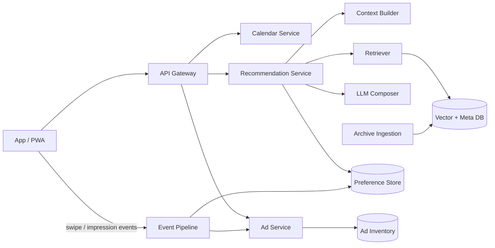

# Mag L!fe 本格設計

プロトタイプ（`calendar/`、[CALENDAR_APP_DESIGN.md](CALENDAR_APP_DESIGN.md)）の次段階。雑誌アーカイブを資産に「予定の隙間を編集部が埋める」体験を、本番品質で作るための設計。

## 1. 価値と差別化

- 一言：**「あなたの予定に、編集部がついてくる。」**
- ChatGPT 等との違い：①出典つき（誌名・号・頁）②雑誌の編集視点（文脈・季節・温度感）③取材済みの実在店・実在商品（ハルシネーションなし）④スワイプで嗜好を学習
- 雑誌別の役割：BRUTUS＝街・文化・喫茶、POPEYE＝シティボーイ・外遊び・海、VOCE＝美容・ご褒美、dancyu＝食・手土産

## 2. 全体構成



| コンポーネント | 責務 |
|---|---|
| Calendar Service | 予定 CRUD、Google/Apple カレンダー同期、空き時間算出 |
| Context Builder | 「モーメント」生成：空き枠・直前直後の予定・場所・天気・季節・同行者・予約リード時間 |
| Retriever | モーメントをクエリ化し、アーカイブから候補取得（ベクトル＋メタフィルタ：エリア・営業時間・予算・季節） |
| LLM Composer | 候補のみを根拠にカード文面・一日プランを生成。候補外の店を作らせない |
| Preference Store | スワイプ履歴からタグ別の好み重みを更新 |
| Ad Service | 広告候補の選定・頻度制御・計測（§5） |
| Archive Ingestion | 誌面→記事単位に分割→店/商品の構造化→埋め込み |

## 3. データモデル

```
ArchiveItem   id, magazine, issue, page, published_at, kind(spot|gift|goods|trip|date),
              title, body, place{lat,lng,area,open_hours}, price_band, tags[], season[],
              duration_min, lead_days, image, rights{expires,territory}, embedding
Event         id, user_id, title, date, start, end, place?, attendees?, source(local|google)
Moment        id, event_id?, type(gap|free_day|gift|goods|far_trip|far_date), window, tags[], location?
Suggestion    id, moment_id, items[ArchiveItem], reason, generated_by, ad?
Feedback      suggestion_id, action(like|skip|save|add_to_calendar|ad_click), at
Preference    user_id, tag -> weight, area -> weight, budget
AdCreative    id, advertiser, format, tags[], geo, budget, freq_cap, disclosure, cta_url
```

## 4. AI 設計

1. **モーメント検出**（ルール＋小型 LLM）：予定タイトルの分類（会食/海/誕生日…）。プロトタイプの正規表現を分類器に置換。タイトルは端末またはサーバ内で処理し、広告には渡さない。
2. **検索**：`moment → クエリ文＋フィルタ` でトップ 30 件→嗜好重みで再ランク→多様性（同誌・同エリア連続を避ける）で 5〜8 件。
3. **生成**：候補 JSON を渡し「候補のみ使用・出典必須」のスキーマ出力（カード or 時刻つきプラン）。移動時間は地図 API で検証し、収まらない提案は除外。
4. **「違う」への対応**：skip したタグ・エリアの重みを下げ、次カードを再ランクで即時差し替え（再生成不要）。
5. **評価**：like 率、保存→実行率、出典クリック率、候補外の固有名詞が出た率（0 を目標）。

## 5. 広告設計（詳細）

**基本方針**：編集提案の信頼が資産。広告は必ず「PR」明示・編集枠とは視覚区別・配信は文脈（モーメント）ベース。

| 枠 | 形式 | 配信条件 | 課金 |
|---|---|---|---|
| A. インフィード | スワイプカード | デッキ 4 枚に 1 枚、広告主連続なし、1 日最大 3 枚 | CPM / CPC |
| B. モーメント連動 | 提案内の「手土産」「海グッズ」候補が広告主商品 | モーメント type が一致した場合のみ | CPA（購入・予約） |
| C. 予定への編集部提案 | 日別エージェント内の末尾 1 枠 | 1 日 1 枠 | CPC |
| D. 冠スポンサー企画 | 「〇〇提供 週末の特集」デッキ先頭 | 編集部が承認した企画のみ | 固定枠 |
| E. 雑誌タイアップ | 号の連動企画のアーカイブ記事（PR 表記つき） | 掲載誌と同条件 | 固定＋成果 |

**選定ロジック**：`score = 文脈一致(タグ,エリア,時間帯) × 嗜好適合 × 入札 × 品質`。品質＝過去の like / skip 比。skip 率が高い広告は露出を下げる。
**ガード**：広告は編集ランキングに混ぜず別系統で選定→最後に挿入。センシティブ予定（通院・葬儀等）はモーメント検出の段階で広告非対象。
**計測**：impression / swipe(like|skip) / CTA / 購入。広告主にはタグ単位の集計のみ提供。
**編集部レビュー**：クリエイティブは公開前に編集部が文体・トーンを確認（雑誌の世界観を壊さない）。

## 6. UX 補足

- 提案カードに「予定に追加」「地図」「出典の誌面を見る」
- カレンダー上の予定に小さな編集部アイコン（提案あり）
- 通知：前日夜「明日の午後、2時間空いています」、会食 2 日前に「手土産を決めませんか」、2 か月前に旅行・デート提案
- オフライン可（PWA）、予定はローカル優先

## 7. 権利・プライバシー

- 記事の二次利用範囲（本文引用の長さ・画像）を `rights` で管理、期限切れは自動非表示
- 予定は端末ローカル優先。サーバに送る場合は暗号化・最小項目。広告主へ個別予定は非開示
- 位置情報は同意制

## 8. ロードマップ

| 段階 | 内容 |
|---|---|
| 0（済） | 静的プロトタイプ（ルールベース・サンプルデータ） |
| 1 | 雑誌 1 誌のアーカイブ 500 件を構造化、ベクトル検索＋LLM 生成、アカウント・同期 |
| 2 | 嗜好学習、通知、地図・移動時間、Google カレンダー連携 |
| 3 | 広告配信（A・C）、計測基盤、広告主管理画面 |
| 4 | モーメント連動・購入導線（B）、複数誌対応、冠企画（D） |

## 9. 未決事項

- 雑誌社との契約形態（データ提供・レベニューシェア）
- 初期ターゲット（20 代後半女性 / 30 代男女 など）と最初の 1 誌
- 提案は「誌面そのまま」か「編集部風に再構成」か（権利との兼ね合い）
